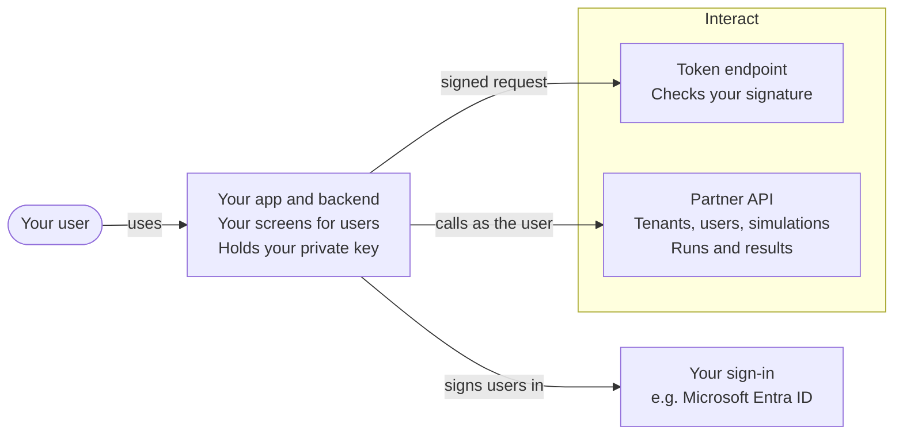
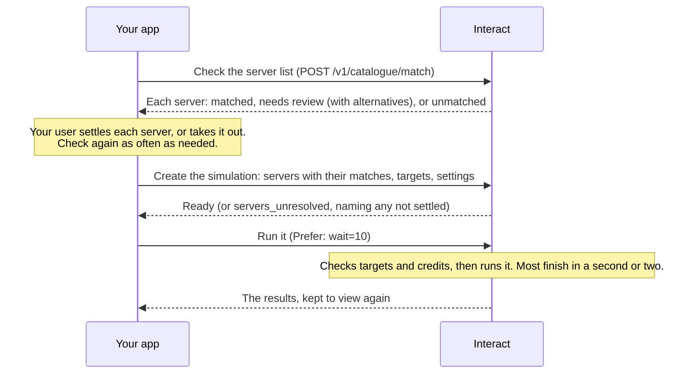

# How it works

Interact lets organisations model the compute capacity, energy use and number of servers their infrastructure workloads need. It also produces compliance reports, such as the EU compliance label. Customers use it through the Interact portal, where they sign in and work directly.

The partner API gives partners the same capabilities from inside their own platform. Each of your customers gets a tenant in Interact, your users sign in with you, and your app defines simulations, runs them and reads the results. There is one standard API, the same for every partner.

## At a glance

Your users sign in with you and only ever use your app. Your backend proves who it is with its own key, then calls the API as each user to set up and run their simulations. Runs are asynchronous, but most finish within a second or two, so the result usually comes back in the same call. For a run that takes longer, a webhook tells your backend when it has finished.

## Who does what

You build the screens your users see; we run the simulations, return the results to you and keep a copy for later recall. There is one integration, the same for every partner.

| Area | You | Us |
| --- | --- | --- |
| Your customers | Create a tenant for each one through the API | Set how many tenants you can have |
| Your users | Sign them in, as you do today, and tell us who each one is | Create each user the first time we see them and keep their work theirs |
| Your app | Build the screens: server lists, hardware choice, results | Check, run and store every simulation |
| Credits | Read each tenant's balance and usage through the API | Set and top up each tenant's credits |
| Security | Keep your private key safe | Check every request against your public key |

## Your users

Your users sign in once, in your app, with your own sign-in (for example Microsoft Entra ID). They never see an Interact sign-in and never use our website: your app is their only screen.

When a user does something, your system tells us who they are in a short signed statement: a JSON Web Token (JWT, RFC 7519), signed with the same private key your system uses to get its access tokens (see [Security setup](#security-setup)). It says:

- **Who:** your id for the user, plus their name and email if you have them.
- **Which customer:** the tenant they belong to.
- **Their role:** `admin` or `member` can create and run simulations; `viewer` can only read results and reports.

We trust that statement because only you can sign it. The first time we see a user we create them; after that their simulations and runs are kept as theirs, so each user sees their own history when they come back. To stop a user, deactivate them through the API.

This is how one system acts for a signed-in person in another, the standard OAuth 2.0 Token Exchange (RFC 8693). Your users get a single sign-on experience; we keep a record of who did what.

## Security setup

Your system proves who it is with a key only you hold. No password or shared secret is ever sent to us.

1. **Create a key pair:** a private key and a public key. Keep the private key safe, for example in Azure Key Vault; it never leaves you.
2. **Send us the public key**, or the web address where you publish it (a JWKS URL). A web address lets you change keys without telling us.
3. **We register your system** and give you a client id.
4. **Get an access token:** your system signs a short message with its private key and sends it to our token endpoint. Back comes an access token that lasts a few minutes. Send it with every API call; when it runs out, get another.
5. **Optional: lock it to your network.** Give us your IP ranges and we refuse calls from anywhere else.

This is OAuth 2.0 client credentials with a signed client assertion (`private_key_jwt`, RFC 7523). It is the same method Microsoft Entra ID uses for apps that sign in with a certificate, and standard OAuth libraries support it. Our sample client shows each step in working code.

## Running a simulation

Three calls do the work: check the customer's server list, create the simulation with the settled list, and run it. Your app makes them as the signed-in user, inside their tenant.

**Creating it.** One call carries everything a simulation or compliance report needs: its type, the customer's current servers, any target servers and the settings. What it needs depends on the type:

| Type | Current servers | Target servers |
| --- | --- | --- |
| Estate Refresh, GPU Estate Refresh | The servers in use today | The hardware to replace them with |
| Host to Host, GPU Host to Host | The servers in use today | The target hardware and how many of each |
| Discovery | The servers in use today | None: a snapshot of the current estate |
| EU compliance report | The servers in use today | None: it rates the data centre as it stands |

The settings tune the model: server and GPU utilisation, PUE, energy cost per kWh, maintenance cost per server, licensing cost per core, and the currency.

A compliance report rates one data centre against the EU Energy Efficiency Directive, giving its PUE and WUE on an A to G scale with its energy, carbon and water figures. Instead of targets it takes the data centre's location and facility figures: PUE, WUE, cooling, server utilisation, and the share of power drawn by networking and storage. Every uncertain match must be confirmed, corrected or skipped before a report can run.

**Why matching comes first.** We can only model hardware we know, so every current server is matched to our catalogue before a simulation is created. First you check the list: we say how each server matched, with alternatives for any we are unsure of. Your app then lets the user settle each one or take it out, as often as they need. Then you send the list with each server's match. A simulation is only created when every server is settled, so no server is ever quietly left out of the results.

**Running it.** We check the simulation is ready (at least one matched server, its targets, enough credits), take the credits and run it. Ask us to wait (the standard `Prefer: wait=10` header) and the finished run comes back in the same call. If it takes longer, the reply says it is still running: our webhook tells you when it has finished, or read the run again. Every run is kept, so users can come back to their results, or change the settings and run again.

## Choosing hardware

The hardware screens are the part of your app that needs the most design. The API gives you two tools, the same ones our own website uses:

- **Catalogue search:** look up servers in our hardware catalogue by vendor, model, processor and other details, to build the pickers your users choose target hardware from.
- **Matching:** send a customer's server list and we match each line to the catalogue, with likely candidates where a line is uncertain.

How you present these is up to you.

## Credits, limits and errors

- **Credits:** each tenant has its own balance, which we set and top up. You can read balances and monthly usage through the API. A run that needs more credits than the tenant has is refused with a clear error.
- **Rate limits:** per minute, 1,200 calls for your system, 600 per tenant and 120 per user, the same for every partner. Every response says how much is left; past a limit you get a 429 with how long to wait.
- **Errors:** every error has the same standard shape (RFC 9457) with a stable `code` your app can act on, and a message for people.
- **Support:** every response carries a request id. Quote it to us and we can see exactly what happened to that call, including why a token request was refused.

## Getting started

You build against a staging sandbox first, then move to production with separate keys.

1. We set up your partner account: the modules your customers can use and how many tenants you can have.
2. You send us your public key or its web address, and your IP ranges if you want the lock.
3. We give you a staging client id. Build and test against the sandbox.
4. When you are ready, we repeat steps 2 and 3 for production.

The API reference, as ReDoc or Swagger UI, is live for the staging sandbox at [partners-staging.interactdc.com/developers/](https://partners-staging.interactdc.com/developers/), and will be at partners.interactdc.com/developers/ for production. Its OpenAPI 3.1 description can generate client code in most languages, and the [C# sample client](../README.md) in this repository shows a complete working integration. [Setting up your account](setting-up.md) has the steps in full.

| Part of the API | Status |
| --- | --- |
| Users, security, tenants, credits and usage | Built |
| API reference and OpenAPI description | Built |
| Sample client (C#) | Built |
| Staging sandbox | Built |
| Hardware catalogue and matching | Built |
| Simulations, runs and results | Built |
| Webhooks for finished runs | Built |
| EU compliance labels | Coming |
